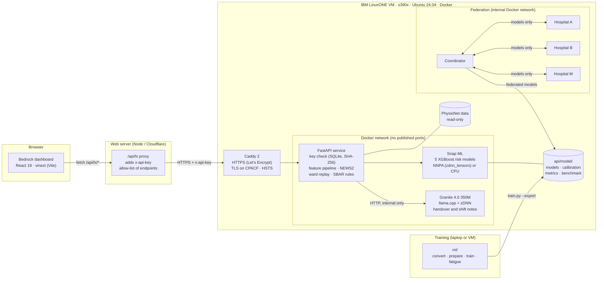

# Bedrock: ICU early warning on IBM LinuxONE

**IBM Z Datathon 2026 · Theme: Real-time AI for Critical Decisions** (with privacy work from *AI Secured: Innovation Without Exposure*) · Event code `SSF2026`

▶️ **Demo video:** https://www.youtube.com/watch?v=FK_NFn7KHJk

Bedrock watches every bed in an ICU and warns nurses **hours before** a patient deteriorates. Five machine learning models score each patient every hour for five risks: sepsis, low blood pressure (hypotension), acute kidney injury, respiratory failure and in-hospital death. Each risk is compared with **NEWS2**, the bedside early-warning score UK hospitals use today. With each model set to raise the same number of alarms as NEWS2, Bedrock warns about more of these events on held-out patients.

Everything runs on an **IBM LinuxONE** virtual machine (s390x):
- the models run in Snap ML, which can use the NNPA (IBM's built-in AI chip on the processor)
- the handover notes are written by an IBM Granite language model on the same machine, so patient data never leaves it
- federated training lets several hospitals build one model together without sharing patient records

> Research prototype built on de-identified public data. **Not a medical device** and not for clinical use.

---

## Contents

- [The problem](#the-problem)
- [What Bedrock does](#what-bedrock-does)
- [Results](#results)
- [Architecture overview](#architecture-overview)
- [How Bedrock uses LinuxONE](#how-bedrock-uses-linuxone)
- [Repository layout](#repository-layout)
- [Running it](#running-it)
- [Open-source resources and data](#open-source-resources-and-data)

---

## The problem

ICU patients can deteriorate within hours. In sepsis, every hour of delayed treatment raises the risk of death. Wards use simple early-warning scores such as **NEWS2** to decide when to call for help, but these scores face a hard trade-off:
- **set the alarm line low**, and they flood staff with alarms (alarm fatigue), so real alarms get ignored
- **set it high**, and they miss patients until it is too late

**Who benefits:**
- **ICU nurses and doctors** get fewer, earlier and better-explained alarms
- **smaller hospitals** that lack the data to train their own models can join a federated model without giving up patient data
- **patients** get treated sooner

## What Bedrock does

| Feature | What it does |
|---|---|
| **Ward board** | Live view of 12 ICU beds, replaying real PhysioNet patients hour by hour. Beds are ranked by priority, with alarms, NEWS2 and all five risks on each bed. |
| **Five risk models** | Sepsis (6 h ahead), hypotension (6 h), acute kidney injury (24 h), respiratory failure (6 h) and in-hospital mortality. Each model's alarm line is set to raise **the same number of alarms as NEWS2 ≥ 5**, so every comparison is like for like. |
| **Patient view** | Risk over the stay, when each model first alarmed compared with NEWS2, what is driving each risk, vital-sign trends, and a "what if" check that re-scores the patient with vitals you type in. |
| **Granite handover note** | An SBAR handover note (Situation, Background, Assessment, Recommendation: the standard nurse handover format). Rules build the facts and the recommendation. Granite 4.0, running on the LinuxONE machine, adds a short spoken summary. Every number in it is checked against the facts, and a predicted risk is never written as a diagnosis. |
| **Ward shift summary** | Granite summary of new and cleared alarms across the ward over the last *n* hours. |
| **Federated learning with a privacy dial** | Hospitals train one shared sepsis model without sharing patient data. Each hospital can add noise to its part of the model (differential privacy) before passing it on. The dashboard shows the trade-off between privacy and accuracy. |
| **Model performance page** | Accuracy per hospital, alarm fatigue curves, fairness by age band and sex, and how well the predicted risks match real outcomes. |
| **LinuxONE system page** | The live machine's architecture and inference backend, the request path, and a speed benchmark of the AI chip (NNPA) against the CPU. |
| **Three designs** | *Ward* (calm, sidebar), *Clinical* (high contrast, table) and *Night* (dark central-station monitor). Alarm sounds, keyboard shortcuts (`Ctrl K`, `Space`, `←/→`, `W`, `?`). |

## Results

All results are on held-out patients, i.e. patients the models never trained on.

**Accuracy (AUROC: 1.0 is perfect, 0.5 is guessing)**, as reported by the live API's `/health` endpoint:

| Risk | Bedrock |
|---|---|
| Sepsis | 0.844 |
| Hypotension | 0.870 |
| Acute kidney injury | 0.814 |
| Respiratory failure | 0.863 |
| In-hospital mortality | 0.796 |

The **Model performance** page has the full comparison with NEWS2, per hospital. It includes the external eICU hospitals, which no model was trained or tuned on.

**Federated sepsis model** (AUROC on each hospital's held-out patients, trained on LinuxONE):

| Model | Hospital A | Hospital B | Mean |
|---|---|---|---|
| Hospital A alone | 0.829 | 0.760 | 0.795 |
| Hospital B alone | 0.785 | 0.876 | 0.830 |
| **Federated, no noise** | 0.817 | 0.867 | **0.842** |
| Federated, ε = 1 per tree | 0.808 | 0.867 | 0.837 |
| Centralised (pooled data, simulation only) | 0.827 | 0.871 | 0.848 |

A model trained at one hospital loses accuracy at another hospital (A's model drops to 0.760 on B's patients). The federated model works at both, and comes close to pooling all the data, without any patient data moving.

---

## Architecture overview



### 1. Data and training (`ml/`)

| Step | File | What happens |
|---|---|---|
| Convert | `ml/p2012/convert.py`, `ml/eicu/convert.py` | Converts PhysioNet 2012 and the eICU demo into the PhysioNet 2019 hourly `.psv` format: one row per ICU hour, `NaN` where nothing was measured. eICU has no sepsis onset time, so its sepsis label is a stand-in taken from the first sepsis diagnosis. |
| Label | `ml/labels.py` | Builds each label from the raw hourly data. Each label asks "does the event *first* happen within the next H hours?", so the models predict **new** deteriorations. Hypotension is MAP < 65 for 2 h. AKI uses the KDIGO creatinine rule. Respiratory failure is SpO₂ < 90 for 2 h, or FiO₂ up by ≥ 0.2. |
| Prepare | `ml/prepare.py` | Loads every source (sites A, B, M, C) and computes features with **the API's own** `api/app/features.py`, so training and serving can't drift apart. Caches everything to `ml/cache/data.npz`. |
| Train | `ml/train.py` | One XGBoost model per risk (patients split 70/15/15). Each model's raw score is turned into a calibrated probability per site (isotonic regression), and its alarm line is set to match NEWS2 ≥ 5's alarm count. Compared with NEWS2 and a single-vital baseline. `--export` writes the models, `features.json`, `impute.json`, `calibration.json`, `metrics.json`, `test_patients.json` and `parity.npz` to `api/model/`. |
| Alarm fatigue | `ml/fatigue.py` | Alarms per bed-day, share of hours alarming, events caught, fairness by age and sex, and the official PhysioNet 2019 utility score. Writes `fatigue.json`. |

**Data sites:**

| Site | Source | Used for |
|---|---|---|
| A, B | PhysioNet 2019 Sepsis Challenge, hospitals A and B | Training (sepsis, hypotension, AKI, respiratory) |
| M | PhysioNet 2012 Challenge, first 48 h of ICU stays | Training (hypotension, AKI, mortality) |
| C | eICU demo (20+ US hospitals) | **External test only.** The one exception: the respiratory model also trains on part of it. |

**Features** (`api/app/features.py`): 40 raw hourly variables (vitals, labs, demographics, ICU time) become **107 features**: 6-hour means, minimums and maximums, trends, hours since each lab was last measured, and NEWS2. Hour *t* only uses hours 0…*t*, so the model never sees the future. Features use numpy only, so they run unchanged on s390x. Snap ML ignores XGBoost's missing-value branches, so missing values are filled with the same stored medians (`impute.json`) at training and serving time.

### 2. Inference API (`api/`, on LinuxONE)

A FastAPI service in a Docker container on the LinuxONE VM.

| Endpoint | Purpose |
|---|---|
| `GET /health` | Architecture (`s390x`, big-endian), backend (`snapml`), `tree_format` (`zdnn_tensors` = NNPA, `compress_trees` = CPU), models, test AUROC. No key needed. |
| `POST /predict` | Scores the given rows or histories with all five models: probabilities, alarm, threshold, drivers, latency |
| `POST /news2` | NEWS2 scores and components |
| `GET /ward?hour=N` | The 12-bed demo ward at replay hour N, with every risk, alarm, NEWS2 and priority per bed |
| `GET /patient/{id}` | One patient's stay up to `hour` (a replay never shows the future) |
| `POST /handover/{id}` | SBAR handover note: rule-based facts plus a checked Granite summary |
| `POST /shift-summary` | Granite ward summary over the last *n* hours |
| `GET /metrics`, `/fatigue`, `/privacy`, `/benchmark` | Results and benchmark data behind the dashboard's analysis pages |

- **Model loading** (`app/model.py`): loads the five XGBoost models into Snap ML. `TREE_FORMAT` picks NNPA (`zdnn_tensors`) or CPU (`compress_trees`). Until the models are exported, a NEWS2-based stand-in returns the same response shapes. All five models share one feature pass per bed. `priority` is the highest of each model's risk ÷ its alarm line, and the ward is sorted by it.
- **Drivers**: how much a risk rises when each variable is set back to the population value, so nurses see *why* a bed is alarming.
- **Ward replay** (`app/ward.py`): replays real held-out PhysioNet patients hour by hour.
- **Handover** (`app/handover.py`): rules build the SBAR from the data. Granite writes a short summary, which is rejected (`verified: false`) if any number doesn't appear in the facts, or if a condition is named without the word "risk".

### 3. Generative AI (`api/granite/`, on LinuxONE)

- Built from IBM's LinuxONE image (`registry.linuxone.cloud.marist.edu/l1cc/jupyterlab-image-s390x`). That image's **llama.cpp is built with zDNN** (the NNPA library) and OpenBLAS.
- Runs **Granite 4.0 H 350M instruct** (bf16 GGUF, converted to big-endian for s390x) behind a small HTTP server. It takes about 15 s per note on 3 cores. The 3B micro model writes better notes but takes around 2 minutes.
- **No published port**: only the API container can reach it, and no patient data leaves the VM.

### 4. Federated learning (`fed/`, on LinuxONE)

- **Cyclic federated XGBoost:** the sepsis model travels from hospital container to hospital container. Each hospital adds a few trees trained on its own patients, then passes it on.
- **Each hospital container mounts only its own data, read-only,** on an **internal** Docker network with no internet and no published ports.
- The coordinator mounts no patient data. It only ever sees models, held-out scores and feature medians (averaged into a shared fill-in value for missing data).
- **Privacy dial** (`fed/dp.py`): Laplace noise is added to every leaf a hospital contributes, before the model leaves that hospital. This uses the DPBoost bound and gives **row-level** differential privacy per tree. Privacy loss adds up across trees, and split thresholds are not noised, so it demonstrates the trade-off rather than certifying a guarantee.
- Hospital containers use Ubuntu's s390x build of `python3-xgboost`. The API then serves the federated models with Snap ML.

### 5. Web dashboard (`web/`)

- **React 19** App Router app, bundled by **vinext** (Next.js-style routing on **Vite 8**), styled with **Tailwind CSS 4** and Sass. It can be deployed to **Cloudflare Workers** with Wrangler.
- **Server-side proxy** (`src/app/api/lx/[...path]/route.ts`): only allows the API's own endpoints and adds `x-api-key` from `LINUXONE_API_KEY` on the server, so **the API key never reaches the browser** and the API needs no CORS.
- **Data sources:** `live` (the LinuxONE API) or `mock` (fixed demo data in the browser, as a fallback if the VM goes down mid-demo). Can be switched at runtime.
- **State:** `DesignContext` (design, data source), `ReplayContext` (one clock for every screen), `WardContext` (one `/ward` call per replay hour), `AlarmContext` (acknowledgement and escalation), `ToastContext` and `ModalContext`.
- **Feature flags:** `NEXT_PUBLIC_*` in `.env.local`; see [`web/DASHBOARD.md`](web/DASHBOARD.md).

### 6. Demo video (`video/`)

A 2-minute film built with **Remotion**: every frame is React and uses Bedrock's own design. Puppeteer captures product shots of the app running against the live LinuxONE API, every number on screen comes from the API, and the soundtrack is generated with numpy. See [`video/README.md`](video/README.md).

### Security

| Layer | Control |
|---|---|
| Transport | HTTPS only through Caddy with Let's Encrypt. `http://` gets a 308 redirect, responses carry HSTS, and TLS runs on **CPACF** (the s390x crypto accelerator). |
| Network | The API and Granite have **no published ports**. Port 8000 is closed in iptables. Federation runs on an internal Docker network. |
| Authentication | Every endpoint except `/health` needs `x-api-key`. A key is a `cuid2` id plus a 256-bit secret, and **only the SHA-256 hash of the secret is stored** (SQLite, mounted in, never in git or the image). Keys are compared in constant time, can be revoked, and record when they were last used. With no keys, every request is refused. `/docs` and `/openapi.json` are turned off. |
| Browser | The key lives only on the web server (proxy), never in the browser. |
| Data | De-identified PhysioNet research data. Granite runs on the VM, so no data goes to a third-party AI service. Federated hospitals share models, not records. |
| Known gaps | No rate limiting and no per-user roles. A real hospital deployment would need SSO and a per-user audit trail. |

## How Bedrock uses LinuxONE

| Capability | How Bedrock uses it |
|---|---|
| **s390x architecture** | The API, Granite and the federated hospitals all run natively on the LinuxONE VM (big-endian). The scientific Python stack comes from Ubuntu's s390x packages, and the Granite model is converted to big-endian. |
| **IBM Integrated Accelerator for AI (NNPA)** | Snap ML can run the models on NNPA (`zdnn_tensors`, via `libzdnn0`). Granite runs through llama.cpp built with zDNN. |
| **Snap ML** | IBM's ML library serves all five XGBoost models. Its results match the XGBoost export to within 5e-7. |
| **CPACF** | Hardware crypto for the HTTPS/TLS connection. |
| **Containers** | Docker Compose stacks for the API (api, caddy, granite) and for federation (three hospitals and a coordinator), with network isolation. |
| **Compute** | Federated training runs end to end on 3 cores in about 3 minutes. Inference reaches 1.73M rows/s on the CPU path. |

**NNPA vs CPU benchmark** (sepsis model, 3-core LinuxONE VM, `api/bench.py`, served at `GET /benchmark`):

| Backend | 1 row | 12 rows (ward) | 10k rows | Throughput at 10k |
|---|---|---|---|---|
| Snap ML, NNPA (`zdnn_tensors`) | 0.089 ms | 0.143 ms | 30.7 ms | 0.33M rows/s |
| Snap ML, CPU (`compress_trees`) | 0.013 ms | 0.043 ms | 5.8 ms | 1.73M rows/s |
| XGBoost 2.0.3, CPU | 0.212 ms | 0.208 ms | 12.1 ms | 0.82M rows/s |

For these models (100–575 trees, each 6 levels deep), Snap ML's CPU path is faster than the NNPA path. Set `TREE_FORMAT=compress_trees` to serve on the CPU. A full 12-bed ward is scored in well under a millisecond either way.

---

## Repository layout

```
api/      FastAPI inference service, Snap ML model loading, Granite handover, Caddy, Docker Compose   → api/README.md
  app/      main.py (endpoints) · model.py · features.py · news2.py · ward.py · handover.py · keys.py
  granite/  Granite 4.0 server image (llama.cpp + zDNN)
  caddy/    Caddyfile (HTTPS front door)
  bench.py  NNPA vs CPU benchmark
fed/      Federated XGBoost: hospital nodes, coordinator, differential privacy, Docker Compose        → fed/README.md
ml/       Data conversion, labels, feature cache, training, alarm-fatigue analysis
web/      Bedrock dashboard (React 19 + vinext/Vite + Tailwind)                                      → web/DASHBOARD.md
video/    Remotion demo film                                                                         → video/README.md
```

## Running it

**Dashboard** (Node 22 + Bun):

```bash
cd web
cp .env.example .env.local      # set LINUXONE_API_KEY, or NEXT_PUBLIC_DATA_SOURCE=mock for demo data
bun install
bun run dev                     # http://localhost:3000
```

**Training** (Python 3.12 + uv; see [`api/README.md`](api/README.md) for the dataset paths):

```bash
cd ml && uv venv -p 3.12 .venv && uv pip install -p .venv -r requirements.txt
.venv/bin/python prepare.py
.venv/bin/python train.py --export
.venv/bin/python fatigue.py
```

**API on LinuxONE:**

```bash
rsync -az --delete --exclude model/ --exclude .env --exclude keys/ api/ l1:~/mfc/api/ && rsync -az api/model/ l1:~/mfc/api/model/
ssh l1 'cd ~/mfc/api && sudo docker compose up -d --build'
ssh l1 'cd ~/mfc/api && sudo docker compose exec -T api python3 -m app.keys create "web"'   # prints the key once
```

**Federation on LinuxONE:**

```bash
sudo docker compose -f fed/docker-compose.yml up -d --build hospital-a hospital-b hospital-m
sudo docker compose -f fed/docker-compose.yml --profile run run --rm coordinator
```

---

## Open-source resources and data

### Datasets

| Dataset | Use | Link |
|---|---|---|
| PhysioNet/CinC Challenge 2019: Early Prediction of Sepsis from Clinical Data | Training and test (hospitals A, B) | https://physionet.org/content/challenge-2019/1.0.0/ |
| PhysioNet/CinC Challenge 2012: Predicting Mortality of ICU Patients | Training and test (hospital M) | https://physionet.org/content/challenge-2012/1.0.0/ |
| eICU Collaborative Research Database Demo v2.0.1 | External test (hospital C) | https://physionet.org/content/eicu-crd-demo/2.0.1/ |

### Clinical and research references

| Reference | Use | Link |
|---|---|---|
| NEWS2 (Royal College of Physicians) | Baseline score and alarm lines | https://www.rcp.ac.uk/improving-care/resources/national-early-warning-score-news-2/ |
| KDIGO Clinical Practice Guideline for Acute Kidney Injury | AKI label | https://kdigo.org/guidelines/acute-kidney-injury/ |
| Reyna et al., *Early Prediction of Sepsis From Clinical Data: the PhysioNet/CinC Challenge 2019* | Sepsis label and utility score | https://physionet.org/content/challenge-2019/1.0.0/ |
| Li et al., *Privacy-Preserving Gradient Boosting Decision Trees* (DPBoost, AAAI 2020) | Leaf sensitivity bound behind the privacy dial | https://arxiv.org/abs/1911.04209 |
| NVIDIA FLARE, cyclic federated learning | The cyclic training pattern (concept only, not a dependency) | https://nvflare.readthedocs.io/ |

### IBM platform and AI

| Resource | Use | Link |
|---|---|---|
| IBM LinuxONE Community Cloud | The VM everything runs on | https://linuxone.cloud.marist.edu/ |
| LinuxONE Community Cloud JupyterLab ML image | Base image for the Granite container | https://github.com/linuxone-community-cloud/jupyter-lab-ml |
| IBM Snap ML | Model inference on NNPA and CPU | https://www.zurich.ibm.com/snapml/ · https://pypi.org/project/snapml/ |
| IBM zDNN | NNPA library (`libzdnn0`) for Snap ML and llama.cpp | https://github.com/IBM/zDNN |
| IBM Granite 4.0 H 350M (GGUF) | Handover and shift summaries | https://huggingface.co/ibm-granite/granite-4.0-h-350m-GGUF |
| IBM Granite 4.0 H Micro (GGUF) | Optional larger summary model | https://huggingface.co/ibm-granite/granite-4.0-h-micro-GGUF |

### Machine learning and backend (Python)

| Package | Use | Link |
|---|---|---|
| XGBoost (2.1.4 for training, Ubuntu's 2.0.3 on s390x) | Risk models and federated trees | https://github.com/dmlc/xgboost |
| scikit-learn | Isotonic calibration, AUROC/AUPRC | https://scikit-learn.org/ |
| NumPy | Features, labels, audio synthesis | https://numpy.org/ |
| SciPy | Dependency of Snap ML and scikit-learn | https://scipy.org/ |
| pandas | Dataset conversion | https://pandas.pydata.org/ |
| PyArrow | Fast data I/O | https://arrow.apache.org/docs/python/ |
| FastAPI | API and federated hospital node servers | https://fastapi.tiangolo.com/ |
| Pydantic | Request validation | https://docs.pydantic.dev/ |
| Uvicorn | ASGI server | https://www.uvicorn.org/ |
| cuid2 (Python) | API key ids | https://pypi.org/project/cuid2/ |
| llama.cpp | Granite inference (built with zDNN in IBM's image) | https://github.com/ggml-org/llama.cpp |
| llama-cpp-python | Python bindings for llama.cpp | https://github.com/abetlen/llama-cpp-python |
| gguf (`gguf_convert_endian.py`) | Byte-swaps Granite to big-endian | https://pypi.org/project/gguf/ |
| uv | Python environments | https://github.com/astral-sh/uv |

### Infrastructure

| Tool | Use | Link |
|---|---|---|
| Docker and Docker Compose | Containers for the API, Granite, Caddy and federation | https://www.docker.com/ |
| Ubuntu 24.04 | Base image with s390x packages | https://ubuntu.com/ |
| Caddy 2 | HTTPS reverse proxy with automatic certificates | https://caddyserver.com/ |
| Let's Encrypt | TLS certificates | https://letsencrypt.org/ |
| sslip.io | DNS name for the VM's IP | https://sslip.io/ |
| SQLite | API key store | https://www.sqlite.org/ |
| Cloudflare Wrangler | Optional deployment of the dashboard | https://developers.cloudflare.com/workers/wrangler/ |

### Web dashboard

| Package | Use | Link |
|---|---|---|
| NNT (Next.js Template) | Starting template for `web/` | https://github.com/Nitlix/NNT |
| React and React DOM | UI | https://react.dev/ |
| vinext | Next.js-style App Router on Vite | https://www.npmjs.com/package/vinext |
| Vite | Bundler and dev server | https://vite.dev/ |
| @vitejs/plugin-react, @vitejs/plugin-rsc | React and React Server Components for Vite | https://github.com/vitejs/vite-plugin-react |
| @cloudflare/vite-plugin, @vinext/cloudflare | Cloudflare Workers build | https://www.npmjs.com/package/@cloudflare/vite-plugin |
| Tailwind CSS (+ @tailwindcss/postcss, @tailwindcss/vite) | Styling | https://tailwindcss.com/ |
| Sass | SCSS modules | https://sass-lang.com/ |
| PostCSS, postcss-nesting, Autoprefixer | CSS processing | https://postcss.org/ |
| tailwind-merge | Class merging | https://github.com/dcastil/tailwind-merge |
| next-themes | Light/dark mode | https://github.com/pacocoursey/next-themes |
| React Icons (Lucide set) | Icons | https://react-icons.github.io/react-icons/ |
| Lenis | Smooth scrolling (from the template) | https://github.com/darkroomengineering/lenis |
| nitlix-metagen, nitlix-aos, lixnet | Metadata, scroll animations and utilities (from the template) | https://www.npmjs.com/package/nitlix-metagen · https://www.npmjs.com/package/nitlix-aos · https://www.npmjs.com/package/lixnet |
| Instrument Sans (SIL OFL 1.1) | Typeface | https://fonts.google.com/specimen/Instrument+Sans |
| TypeScript | Types | https://www.typescriptlang.org/ |

The template also installs packages that Bedrock doesn't use at runtime: Drizzle ORM ([link](https://orm.drizzle.team/)), Neon serverless ([link](https://github.com/neondatabase/serverless)), GSAP ([link](https://gsap.com/)), the Cloudflare SDK ([link](https://github.com/cloudflare/cloudflare-typescript)), `@paralleldrive/cuid2` ([link](https://github.com/paralleldrive/cuid2)) and `@vercel/edge` ([link](https://www.npmjs.com/package/@vercel/edge)).

### Demo video

| Package | Use | Link |
|---|---|---|
| Remotion | Video rendered from React | https://www.remotion.dev/ |
| Puppeteer | Captures product shots of the app | https://pptr.dev/ |
